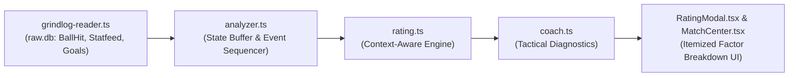

# High-Precision Context-Aware Football-Style Match Rating & Analytics Engine

> **Design Specification**  
> **Status:** Draft / Approved Design  
> **Date:** 2026-11-25  
> **Author:** Antigravity Engineering Team & User  
> **Target:** OvertimeRL (`src/server/models/rating.ts`, `src/server/models/analyzer.ts`, `src/server/models/coach.ts`, `src/shared/types.ts`)

---

## 1. Executive Summary & Objective

In fast-paced car-soccer (Rocket League), conventional stat trackers reward raw stat-padding (goal-hanging, stealing low-value touches, booming balls to opponents) while unfairly penalizing players who execute legitimate high-level tactical play (e.g. crossing to an open slot where a teammate hesitates, or making honest goal-line defensive efforts against unsavable shots).

This engine implements an advanced, **context-aware, football (soccer)-inspired match rating and analytics system**. Every player begins at **6.0** (clamped strictly to `0.0–10.0`), dynamically modulated by an event-driven **rolling ~5-second spatial buffer**, a **3-state possession state machine**, **causal liability attribution**, and **game-state multipliers**.

The entire engine runs **100% locally, deterministically, and offline** in Node/TypeScript without external AI or network calls, executing in $<35\text{ ms}$ per match.

---

## 2. Core Primitives & Anti-Exploit Mechanics

### 2.1 Touch Grouping / Debouncing
* **Problem:** Dribbling, wall-grinding, and pinch mechanics generate multiple physics touch ticks within milliseconds, which artificially inflates touch counts and duel stats.
* **Rule:** Any consecutive `BallHit` events by the same player occurring $< 0.35\text{ seconds}$ apart are grouped into a single contiguous **Possession Sequence**.
* **Impact:** 
  - Prevents multi-touch stat spam.
  - Allows clean calculation of initial touch vs. release/shot vector.

### 2.2 Three-State Possession State Machine
At every point in match time, ball possession is classified into one of three discrete states:
1. **`Controlled Possession`:** A single player registers $\ge 2$ debounced touches or carries the ball with velocity aligned with car heading for $> 0.6\text{s}$ without an opposing touch.
2. **`Contested / 50-50`:** Two or more players from opposing teams make contact with the ball within $< 0.40\text{s}$ of each other, or engage within a $350\text{ uu}$ sphere around the ball.
3. **`Loose Ball`:** The ball is moving freely after a clearance, 50/50 exit, or rebound, without active possession by any player.

### 2.3 Rolling 5-Second Spatial & Physics History Buffer
The engine maintains a sliding FIFO buffer of all game events (`BallHit`, `StatfeedEvent`, player positions, velocities, and boost levels) over a rolling $5.0\text{-second}$ window.
* When a major event occurs (e.g. `GoalScored`, `Save`, `Turnover`), the engine rewinds the preceding $5.0\text{s}$ to identify root causes and evaluate player intent.

### 2.4 Favorable Pass Proximity Check ($D_{\text{Teammate}} < D_{\text{Opponent}}$)
When a player crosses or passes the ball into the attacking box ($Y > 1,500$, $|X| < 1,500$):
$$\Delta D = \min_{i}(\text{dist}(\text{Ball Target}, \text{Opponent}_i)) - \text{dist}(\text{Ball Target}, \text{Teammate})$$
* **If $\Delta D > 0$ (Favorable Delivery):** The passer delivered the ball closer to their teammate than to any defender. The passer receives **+0.45 to +0.60 (Prime Chance Created)**.
* **If $\Delta D \le 0$ (Hospital Pass):** The passer hit the ball directly into defending traffic with their teammate out of position ($-0.30$).

### 2.5 Single-Primary-Cause Conflict Resolution
When a goal is conceded or an unforced error occurs, the engine evaluates the candidate causal rules (e.g., Whiff, Spectator, Boost Abandonment, Turnover) and assigns **only the single highest-impact primary cause**. Overlapping or contradictory negative penalties are never stacked on the same player for a single event.

---

## 3. Comprehensive Rating Rules & Weight Matrix

### 3.1 Goals & Finishing (xG / Shot Quality)

| Event | Rating Delta | Criteria |
| :--- | :---: | :--- |
| **Long-Range Screamer** | **$+1.20\text{ to }+1.80$** | Shot originates outside attacking third ($Y < 1,024$) with velocity $> 100\text{ km/h}$. Harder angles scale toward $+1.80$. |
| **Solo Run / Take-On Goal** | **$+1.50$** | Scorer bypasses $\ge 2$ defenders in close proximity via dribble/flick/air-dribble in the attacking third before scoring. |
| **1- or 2-Touch Counter Goal** | **$+1.30$** | Possession won in defensive or midfield half, resulting in a goal within $\le 2$ touches and $\le 5.0\text{s}$ (scorer gets $+1.30$; passer gets $+0.80$). |
| **Tap-In Finish** | **$+0.40$** | Close-range ($< 1,200\text{ uu}$ from net), high-xG ($> 0.65$) uncontested finish. Modest score for shooter; primary credit goes to assister. |
| **Big Chance Created** | **$+0.90$** | Delivering an open-net or high-xG ($> 0.60$) shooting opportunity to a teammate. |
| **Soft Goal** | **$+0.50$** | Slow rolling long goal into an empty net caused by defender error rather than offensive velocity. |
| **Big Chance Missed** | **$-0.30$** | Missing the frame on an uncontested open-net look or shot with $xG \ge 0.60$. |
| **Tough Angle / Long Shot Miss** | **$0.00\text{ to }-0.05$** | Contested or low-xG shot off target; negligible penalty. |

### 3.2 Defensive Accountability & Conceded Goals (5s Rewind)

| Event | Rating Delta | Criteria |
| :--- | :---: | :--- |
| **Honest Effort** | **$-0.15$** | Defender positioned in defensive box, actively moving toward ball trajectory, or making partial contact attempting a save. |
| **Spectator on Savable Ball** | **$-0.45$** | Defender positioned in net/box with near-zero velocity or defensive reaction on a shot that was physically reachable. |
| **Boost-Over-Ball Abandonment** | **$-0.75$** | Vacating the defensive half for a 100-boost orb while opponents already control possession in the defensive third, directly yielding a goal. |
| **Fast-Break Exception** | **$0.00$** | Team was attacking in the opponent's final third and conceded within $\le 4.0\text{s}$ of an unexpected turnover. Distant offensive players receive $0.0$ penalty. |
| **Unforced Own Goal** | **$-0.60$** | Last touch directly redirecting a non-threatening ball into the player's own net. |
| **Deflected Own Goal** | **$-0.15$** | Skimming or redirecting a high-speed shot that was already on target while attempting an emergency save. |
| **Kickoff Breakdown** | **$-0.40$** | Conceding within $\le 3.0\text{s}$ of kickoff due to a completely whiffed kickoff or rear defender cheating out early for boost. |
| **Failed Recovery on Open Slot** | **$-0.50$** | Teammate B had spatial priority on a Favorable Pass ($\Delta D > 0$) but hesitated or whiffed, gifting opponents a counter-attack goal. |

### 3.3 Goalkeeping & Saves (PSxG + Rebound Recovery)

| Event | Rating Delta | Criteria |
| :--- | :---: | :--- |
| **Reflex / High-Danger Save** | **$+0.65$** | Stopping a shot with Post-Shot xG ($PSxG \ge 0.65$) aimed inside the frame from close range. |
| **Routine Save** | **$+0.25$** | Stopping a slow or long-range shot with low threat ($PSxG < 0.35$). |
| **Controlled Rebound Parry** | **$+0.15$** | Parrying a save safely toward the corner wall away from danger. |
| **Spilled Rebound into Danger** | **$-0.25$** | Parrying a save dead-center into the slot with an unmarked opponent nearby. |
| **Instant Rebound Clear Waiver** | **$0.00$** | If the same keeper follows up and clears/secures their own spilled rebound within $\le 2.5\text{s}$, the $-0.25$ penalty is completely waived to $0.00$. |

### 3.4 Tackles, Aerial Duels & 50/50s (With Recovery Waivers)

| Event | Rating Delta | Criteria |
| :--- | :---: | :--- |
| **Clean Tackle / Dispossession** | **$+0.25$** | Winning the ball cleanly from an active opponent ball-carrier while maintaining match involvement. |
| **Last-Man Tackle** | **$+0.55$** | Dispossessing a breakaway attacker as the final defender protecting an open goal. |
| **Beaten on Challenge** | **$-0.15$** | Getting cleanly beaten on a shadow challenge while rotating back. |
| **Reckless Last-Man Dive** | **$-0.45$** | Diving out of position as the last man without touching the ball, leaving the net defenseless. |
| **Challenge Recovery Waiver** | **$50\%\text{ Waiver}$** | If a beaten player recovers to block, save, or win the ball within $\le 3.5\text{s}$, the penalty is halved (or fully waived to $0.0$ if preventing a goal). |
| **50/50 Duel Won** | **$+0.20$** | Simultaneous touch where the exit vector propels the ball toward the opponent half or cleanly to a teammate. |
| **50/50 Duel Lost** | **$-0.20$** | Simultaneous touch where the exit vector bounces dangerously toward own net or unmarked opponent. |
| **50/50 Winning Streak** | **$+0.15$** | Bonus awarded upon winning 3 consecutive 50/50 duels. |
| **50/50 Losing Streak** | **$-0.15$** | Deduction applied upon losing 3 consecutive 50/50 duels. |
| **Aerial Duel Won** | **$+0.30$** | Contesting and winning a high ball above crossbar height ($Z > 650\text{ uu}$). |
| **Aerial Whiff** | **$-0.25$** | Committing into the air for a high ball, completely missing, and taking yourself out of the rotation. |
| **Tactical Demo** | **$+0.40$** | Demolishing the goalkeeper or last defender within $\le 3.0\text{s}$ of a teammate's shot or goal. |
| **Off-Ball Demo** | **$0.00$** | Neutral demo occurring far from the active ball play. |

### 3.5 Passing, Possession Loss & The 5-Second Win-Back Rule

| Event | Rating Delta | Criteria |
| :--- | :---: | :--- |
| **Completed Pass** | **$+0.08$** | Pass cleanly received by teammate without immediate opponent intervention. |
| **Progressive / Backboard Pass** | **$+0.30$** | Centering the ball off the opponent backboard or bypassing $\ge 2$ defenders directly into a teammate's shooting lane. |
| **Hockey Assist (Pre-Assist)** | **$+0.35$** | The decisive pass leading directly to the assist within $\le 3.5\text{s}$. |
| **Pressure Clearance** | **$+0.15$** | Booming clearance out of defensive third under heavy pressure (exempt from turnover penalties). |
| **Press Resistance** | **$+0.20$** | Executing a clean pass or flick while an opponent challenges within $< 500\text{ uu}$. |
| **5-Second Win-Back Waiver** | **$0.00\text{ (+0.15 bonus)}$** | When possession is lost, hold penalty for $5.0\text{s}$. If the player (or a teammate) wins it back within $\le 5.0\text{s}$, deduct $0.0$ and award $+0.15$ for Counter-Press Recovery. |
| **Sloppy-Patch Turnover (3rd+)** | **$-0.20$** | If turnover is unrecovered in $5.0\text{s}$, 1st and 2nd are free; 3rd consecutive unrecovered loss in a 30s window incurs $-0.20$. |
| **Sloppy-Patch Turnover (4th+)** | **$-0.35$** | 4th and subsequent unrecovered turnovers in 30s incur $-0.35$ each. |
| **Zone Risk Multipliers** | **$0.5x / 1.0x / 1.5x$** | Turnover penalty multiplied by $0.5x$ in attack third, $1.0x$ in midfield, and $1.5x$ in defensive box. |

---

## 4. Context & Game-State Modifiers

To reflect true high-pressure match performance, final ratings incorporate situational game-state weighting:

```
                      ┌──────────────────────────────────────────┐
                      │          GAME-STATE MODIFIERS            │
                      └──────────────────────────────────────────┘
                                           │
         ┌─────────────────────────────────┴─────────────────────────────────┐
         ▼                                                                   ▼
┌─────────────────────────────────┐                 ┌─────────────────────────────────┐
│     CLUTCH MULTIPLIER (1.25x)   │                 │  GARBAGE-TIME DAMPENER (0.50x)  │
├─────────────────────────────────┤                 ├─────────────────────────────────┤
│ • Match Time: Final 60s or OT   │                 │ • Match Time: Final 30s         │
│ • Score Diff: ≤ 1 goal          │                 │ • Score Diff: ≥ 4 goals         │
│ • Amplifies: Major saves, goals,│                 │ • Dampens: Unforced turnovers,  │
│   clears, and fatal breakdowns. │                 │   concession penalties, whiffs. │
└─────────────────────────────────┘                 └─────────────────────────────────┘
```

---

## 5. Architectural Pipeline & File Modifications



### Affected Files:
1. **`src/shared/types.ts`**:
   - Extend `PlayerRatingResult` to include full factor itemization with causal categories (`attack`, `defense`, `goalkeeping`, `turnover_recovery`, `clutch`).
   - Add schemas for `TouchSequence`, `PossessionState`, and `DeferredTurnoverEvent`.
2. **`src/server/models/rating.ts`**:
   - Complete re-implementation from static stat multipliers to the rolling-buffer causal scoring matrix.
   - Core functions: `processTouchSequence()`, `evaluateDefensiveRewind()`, `evaluatePassingDelivery()`, `applyGameStateModifier()`.
3. **`src/server/models/analyzer.ts`**:
   - Feeds sequential `BallHit` events into the touch debouncer and 5s spatial buffer.
   - Correlates conceded goals with the 5s rewind sequence to identify primary blame.
4. **`src/web/components/RatingModal.tsx`**:
   - Displays clean categorized breakdown of positive gains vs deductions with clutch badges.

---

## 6. Verification & Test Plan

1. **Unit Tests (`tests/rating_engine.test.js`)**:
   - Touch debouncing $(<0.35\text{s})$ groups multiple hits into one possession event.
   - Favorable pass delivery ($\Delta D > 0$) grants $+0.50$ to creator and shields from counter-attack blame.
   - 5s Counter-press win-back waives turnover penalty to $0.0$ and awards $+0.15$.
   - Spilled rebound waived to $0.0$ when keeper clears within $\le 2.5\text{s}$.
   - Clutch multiplier (1.25x) correctly scales scores in final 60s.
2. **End-to-End Regression Test (`tests/analyzer.test.js`)**:
   - Run complete analysis on real historical matches in `tracker.db` / `raw.db`.
   - Verify performance completes in $<35\text{ ms}$ with zero memory leaks.
3. **UI Verification**:
   - Verify FotMob ratings and itemized factor cards render crisply in `RatingModal.tsx`.
